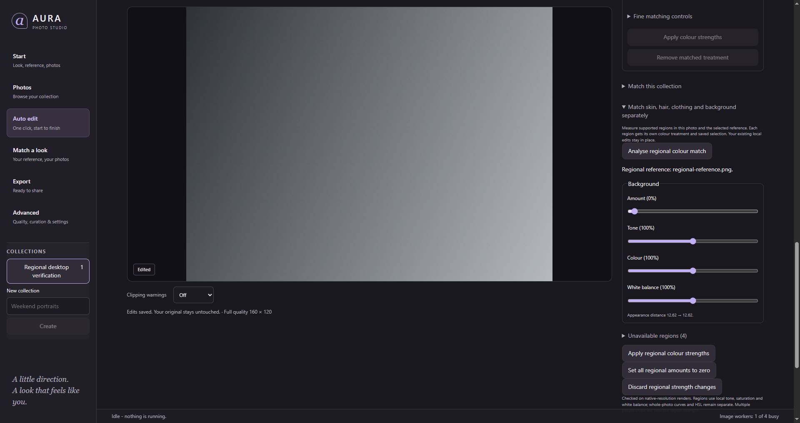

# Evoto 8 native research and regional matching

Date: 2026-10-20. Branch: `feat/evoto-reference-and-adjustable-finishing`.
This continues the [workflow audit](AURA-Evoto-workflows-2026-10-20.md).

## Result

AURA now has genuine regional reference matching and seven editor panels.
Face skin, body skin, hair, clothing and background can each receive independent
amount, tone, colour and white-balance strengths when the segmenter finds usable
regions in both photographs. Existing manual masks stay in place. Zero, history
and reopening retain the original analysis baseline. See the
[workflow guide](../adjustable-finishing-and-reference-colour.md),
[panel guide](../editing-panels.md) and [ADR-0131](../adr/ADR-0131-regional-reference-matching-and-evidence-bound-reconstruction.md).

**This is not full Evoto reconstruction or evidence of identical photographs.**
The trained networks, training data and full processing graph were not recovered.
No fresh paired Evoto/AURA export comparison was performed. The installed-app
inspection from the preceding audit establishes visible controls, not successful
execution of every control or photographic equivalence.

## Target identity

All addresses below refer to this installed 8.0 worker, not the older 7.3.5 worker
examined in previous reports. File size and SHA-256 bind the observations.

| Artifact | Bytes | SHA-256 |
| --- | ---: | --- |
| `F:\evoto\Evoto.exe` | 237784976 | `7f020192f3b659ca4a1e4f8631b21879982bb21d97d26196a604ad70e2f3b2fa` |
| `F:\evoto\Evoto-worker.exe` | 230489488 | `add7588f94aed190b97076f949709ba9622aa14f046b661783135d838d3d3bb2` |
| `F:\evoto\Evoto Photo Editor.exe` | 13312912 | `3e569fdd7aa792c9e6f1025cfb8ae65545af4d6138961877068cd81e4dd61012` |

## REA and fallback provenance

The explicitly requested `reverse-engineer-anything` skill was used. REA 6.7.0
doctor verified client configuration and available analysis tools. REA CLI PE
resource inspection produced GUI evidence
`ev_a19b95ce474b8bc4439edbbe31e8502b5755c901a04fc18339ae9dd420ab1b79`
and worker evidence
`ev_86de4e0b1b16df55bfb59568192d7aab90afe8d3092a16b8c61e9b493fae5bb3`.
When MCP became available, its launcher resource inspection produced
`ev_0312c9cfef3e2ad9e5906b5ea77df09c0e63bc1d5d14d2cbdea280049d3ba5b8`.
These inspect PE metadata; they do not describe the image-editing algorithms.

A REA Ghidra function request for `0x141007ea0` timed out after 330 seconds.
It is recorded as a failure, not a completed native function dossier. A targeted
fallback used the existing Ghidra 12.1.4 installation and a new analysis project
for the current worker. No whole-program analysis was requested. The repository's
bounded scanner selected runtime-function ranges around diagnostic strings;
the Ghidra helper disassembled and decompiled 24 selected ranges. The independent
summary validated all 88 candidate string associations against actual instruction
references/operands. This validates the associations, not all inferred semantics.
Diagnostic-linked labels are not recovered original function signatures.

Scanner inventory: 589 matching ASCII strings, 425 with encoding candidates,
268 candidate ranges, and 289009 unwind ranges. Unwind ranges are not a count of
all source functions. Selected ranges were capped at 16000 bytes; retained
instruction samples and decompiler output are bounded. There is no claim of
complete program coverage, complete call graphs, or runtime branch execution.

## Selected native findings

| Family and selected addresses | Observed static evidence | Interpretation and remaining uncertainty |
| --- | --- | --- |
| White balance: `0x141095650`, `0x141096ec0` | References to processed-AI state diagnostics in two substantial routines | AI-result state participates in WB handling; exact transforms and all fallback branches remain unresolved |
| Model loading: `0x141007ea0`, `0x141008450` | Separate AutoWB and RAW AutoWB loader diagnostics and paths | Separate task wrappers are present; network tensors, weights and training are not recovered |
| Adult blemishes: `0x145e17b20`, `0x145e17fe0`, `0x145e12eb0` | Skin-mask validity and per-face landmark/cache checks | The pipeline has input requirements beyond smoothing a rectangular face area; correctness on any photo is unmeasured |
| Blemish, nevus, freckle and acne wrappers: `0x145e11a60`, `0x145e127d0`, `0x145e121a0`, `0x145e112b0` | Distinct diagnostic-linked inference entry points and output checks | Task separation is supported; this does not identify the learned classifiers or their accuracy |
| Postprocessing: `0x145e155c0`, `0x145e15e30`, `0x145e14f60` | Separate output-validity and postprocess paths | Inference output is checked and composed; numerical retouch behaviour remains unknown |
| Newborn protection: `0x145e1ab80` | Face-parsing validity checks in a feature-protection path | Dedicated protection exists; anatomical coverage and model internals remain unresolved |
| Nose cleanup: `0x145e61810`, `0x145e60090` | Model-loading and instance-mask validation diagnostics | A dedicated task pipeline is present; not a recovered implementation |
| Skin smoothing/unification: `0x144bb8000`, `0x144bbeba0` | Skin-mask failure and skin-unification associations | Mask-dependent effects are supported by static references; filter kernels and trained logic are unknown |
| Makeup composition: `0x141492c30`, `0x141494690` | Separate export/interactive composition paths check makeup-protection data | Protection and composition matter independently; CPU/GPU equivalence and blending order are unqualified |
| Parsing/matte handling: `0x141419960`, `0x14138eca0`, `0x14134b7d0` | Parsing-texture flag, retain-old-cache failure path and result-texture checks | Cache/texture validity paths exist; no claim of identical edge refinement |

These findings guide independent architecture and acceptance tests. They are not
ported competitor pseudocode or substitutes for task models.

## Packaged resources

The metadata-only [audit script](../../scripts/audit-evoto-packaging.py) inspected
1615 resource files totalling 1920847274 bytes. It strictly parsed 620 JSON
configurations: 618 in an empirically verified word-XOR carrier and two plain
UTF-8 files. It reports schema keys, declared effect labels, numeric ranges and
resource references without retaining decoded shader bodies, images, tuning
arrays or networks. Five parser tests pass, including malformed-input cases.

The audit recognized 841 PNG-like effect-resource headers; 840 passed the decoded
IHDR CRC check. The remaining anomaly is recorded, not counted as a valid decoded
image. Header validation does not validate complete image payloads. Declared
families include adult/body/newborn acne, makeup protection, face/body smoothing,
skin unification, reshape, eye effects, skin texture and makeup assets. A declared
effect or asset reference does not establish execution, a neural architecture,
its slider normalization, or a recovered algorithm.

The approximately 1.60 GB `resources/pixcook` container remains opaque. No trained
network or training set was recovered. A bounded resource scan did not find
standalone files with common model extensions; this says nothing about embedded,
packed or differently named models. Small binary resource files must not be
described as trained networks without evidence.

## Implemented regional workflow

The implementation uses AURA's already bundled licensed semantic segmenter and
native renderer. It freezes class selections, fits nine supported local colour
parameters, and saves genuine local masks. It measures the displayed crop while
retaining full-frame mask coordinates. It validates saved metadata and native
resolution output before one atomic history write. Zero restores the analysis
baseline, manual masks and extension-key absence. Content-derived mask identities
keep the resulting recipe deterministic.

No confident shared region produces an explicit unavailable reason. A represented
region with no useful fitted correction is shown with its effect controls
disabled. Multiple people share a class strength; individual people are not
paired to reference subjects. Local curves, hue and vibrance are not claimed.
Global fine matching remains available separately. Editing another recipe field
makes the old regional analysis stale, requiring reanalysis.

The seven panels organize existing tools and preserve unsaved drafts. Automatic
finishing is also available directly in Develop. Hidden picking, drawing and
liquify gestures are deactivated on panel changes. New panel names are not counted
as new image-processing algorithms.

The screenshot uses a generated gradient chart, after restoring the regional
amount to zero. It demonstrates the interface and preview placement, not skin
retouch or photographic quality.

## Verification and unresolved acceptance

- Frontend: 851 tests across 100 files; production build passes.
- Native app: 299 unit tests passed, two ignored; four reference/finishing
  integration tests passed, one optional real-RAW case ignored.
- Workspace strict Clippy passes; 83 frozen contracts remain locked.
- Workspace and desktop formatting, the banned-pattern scan and diff check pass.
- Packaging parser: five tests passed; installed metadata audit completed.
- The Windows production-asset desktop build succeeds with the existing GNU
  resource-manifest merge warning. Six fresh desktop scenarios pass: seven-panel
  navigation, regional analysis with explicit unavailable classes, a 75% draft
  retained across panel switches and applied to actual pixels, pixel-exact zero,
  common Undo/Redo, and unchanged original/reference bytes. Evidence:
  `.work-checks/rea-evoto-2026-10-20/desktop-171421/result.json`.
- The seven automatic-finishing/reference-library desktop scenarios were rerun
  successfully against the same rebuilt app:
  `.work-checks/evoto-research-2026-10-20/desktop-171926/result.json`.
  A subsequent regional replay additionally confirms that the preview remains
  visible when scrolling to the regional controls:
  `.work-checks/rea-evoto-2026-10-20/desktop-172058/result.json`.

Native regression tests include actual regional pixel changes confined to their
frozen support, independent strengths, pixel-exact zero, manual-mask preservation,
cropped rendering, deterministic identities, history, reopening and stale writes.
Synthetic fixtures establish controller/renderer invariants, not photographic
quality across faces, ages, skin tones, hair, veils or patterned clothing.

Remaining acceptance requires fixed, permissioned reference/target cohorts and
paired exported images at native resolution. Assess colour, texture, identity,
mask spill, edge quality, preview/export agreement and cancellation/performance.
Dense anatomy, articulated body geometry, generative expressions/teeth, pet task
models, learned style adaptation and capture-hardware parity remain incomplete.
No exact-parity or best-in-class conclusion follows from this investigation.

The compact [finding ledger](AURA-Evoto-native-research-2026-10-20.json) separates
observed, inferred and unresolved results. Machine-local evidence remains under
`.work-checks/rea-evoto-2026-10-20/`; analysis databases, proprietary resource
payloads and decompiled function bodies are excluded from product sources.
