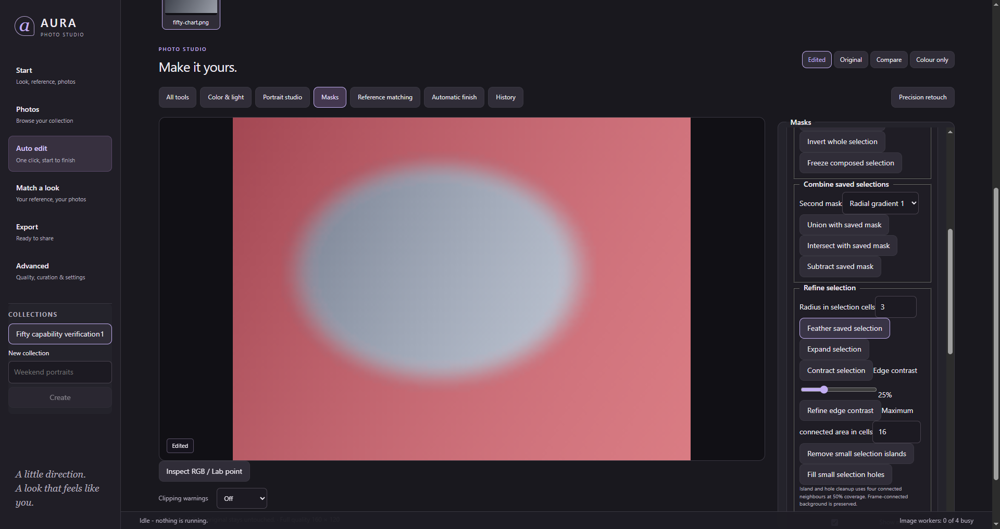
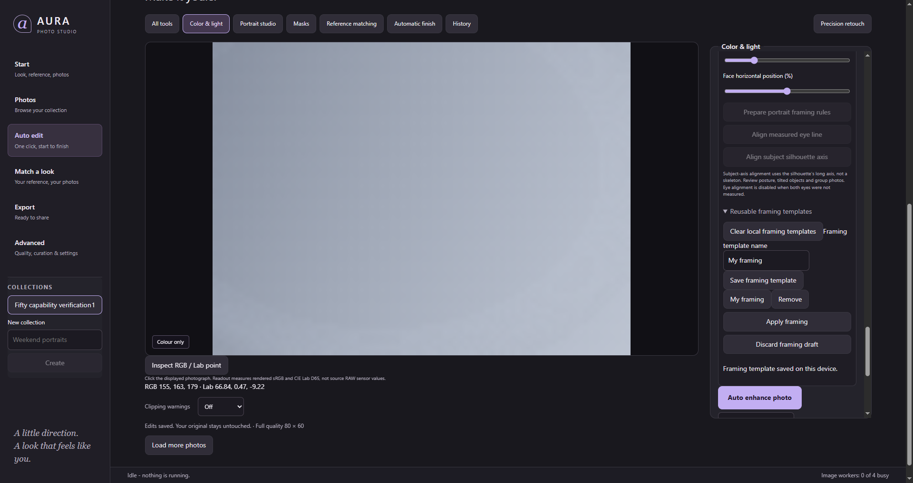

# Fifty additional studio capabilities

The latest request adds [another 100 tools and full-folder validation](AURA-next-hundred-validation-2026-10-21.md), with [the distinct new capability ledger](AURA-next-hundred-capabilities-2026-10-21.json) and [all 1,860 Evoto installation files](AURA-evoto-file-inventory-2026-10-21.csv). That report records current completion and limits; the earlier reports below remain historical.

For the subsequent request, see [fifty further capabilities](AURA-next-fifty-capabilities-2026-10-20.md): material editing, selection authoring and photo inspection. This earlier report and its historical verification remain separate.

The latest continuation adds [100 more capabilities and the 27-RAW qualification](AURA-hundred-capabilities-2026-10-21.md), with the complete tool ledger, desktop results, photo exports and Evoto comparison limits.

The [current correctness and revalidation report](AURA-revalidation-2026-10-21.md)
records the repaired hundred-tool expansion and fresh checks of the rebuilt desktop.

Date: 2026-10-20. Branch: `feat/fifty-studio-capabilities`, based on the
regional matching/adjustable-finishing branch in PR #61.

This continuation adds **50 distinct operations and workflows**. It does not
count the four Levels channels, nine selective-colour ranges, individual
sliders, reset buttons or presets as separate algorithms. Existing tools are
excluded. Several additions extend Evoto-inspired workflows and are explicitly
marked **AURA extension**; this is not a claim that all fifty are Evoto features
or that their implementations produce identical output.

The [research inventory](AURA-fifty-capabilities-research-2026-10-20.md) records
candidates, including excluded/unimplemented ones. The table below is the
implementation list. Design: [ADR-0132](../adr/ADR-0132-fifty-studio-workflow-capabilities.md).
No proprietary code, tuning data, images or weights enter AURA.

## Colour: twelve additions

The [colour guide](../studio-color-tools.md) explains draft/apply operation.
Implementation: `crates/aura-recipe/src/studio_color.rs`,
`crates/aura-render/src/studio_color.rs`,
`crates/aura-app/src/studio_color_commands.rs`, and
`ui/src/components/develop/StudioColorPanel.tsx`.

| # | Working capability | Provenance and practical limit |
| --- | --- | --- |
| 1 | Full-image Levels with joint RGB and independent channels | Documented category; AURA's curve-domain operator |
| 2 | Hue-preserving luminosity Levels | AURA extension; individual channel controls still follow |
| 3 | Nine-range selective CMYK correction, relative/absolute modes | Documented category; independently implemented range weights |
| 4 | Percentile auto Levels | AURA extension; measured endpoints are proposals |
| 5 | Sampled Levels input black point | Documented workflow; bounded coordinate-selected patch |
| 6 | Sampled Levels input white point | Documented workflow; bounded coordinate-selected patch |
| 7 | Mask-local point curves | Documented category; uses the existing mask's coverage |
| 8 | Mask-local eight-band HSL | Documented category; independent local parameters |
| 9 | Mask-local three-way colour grading | Documented category; blending and balance included |
| 10 | Mask-local sharpening | Documented category; not a new semantic detector |
| 11 | Mask-local dehaze | AURA extension; review edge and haze behaviour |
| 12 | Sampled colour targeting for HSL | Documented workflow counterpart; coordinates select the band, not drag-on-image adjustment |

Local vibrance is also exposed but is **not counted**, because AURA already
offers selected vibrance in precision retouch. Global B&W, curves, HSL and
grading likewise do not count again. The existing luminance-preserving curve
is not misrepresented as a new tool.

## Selection editing: twelve additions

The [selection guide](../mask-selection-workflows.md) explains coverage,
quantization, cancellation and history. Implementation:
`crates/aura-app/src/mask_workflows.rs`, its `plane` module, and
`ui/src/components/develop/MaskWorkflowControls.tsx`.

| # | Working capability | Provenance and practical limit |
| --- | --- | --- |
| 13 | Duplicate an authored mask and its extended colour settings | AURA extension to mask management |
| 14 | Invert the whole composed selection | Documented counterpart; not per-component inversion |
| 15 | Union two existing composed mask selections | AURA extension to documented selection combination |
| 16 | Intersect two existing composed mask selections | AURA extension; differs from adding a newly detected component |
| 17 | Subtract an existing composed mask selection | AURA extension; preserves the destination mask's parameters |
| 18 | Freeze computed selection coverage | AURA extension; stores a bounded full-frame matte |
| 19 | Feather the completed selection | Documented refinement category; grid-cell radius |
| 20 | Expand the completed selection | Documented refinement category; bounded dilation |
| 21 | Contract the completed selection | Documented refinement category; bounded erosion |
| 22 | Refine completed selection edge contrast | AURA extension |
| 23 | Remove small isolated selection islands | AURA extension; bounded connected-component area |
| 24 | Fill small enclosed selection holes | AURA extension; border-connected background stays empty |

These operations preserve local parameters and unrelated edits. Frozen coverage
uses the existing maximum-512-cell matte grid and 16 alpha levels. It is an
approximation of the composed native selection, not a full-resolution float
mask. Original components remain recoverable through Undo. Obsolete matte IDs
are pruned so repeated refinements do not exhaust the selection budget.

## Reference library: twelve additions

Open **Reference matching → Organize groups and selected references**.
Implementation: `crates/aura-app/src/color_match/library/workflows.rs` and
`ui/src/components/look/ReferenceLibraryManager.tsx`.

| # | Working capability | Provenance and practical limit |
| --- | --- | --- |
| 25 | Create durable empty reference groups | Documented management counterpart |
| 26 | Rename a group and its members together | Documented management counterpart |
| 27 | Delete a group while safely ungrouping its references | Documented category; source files retained |
| 28 | Manually reorder reference groups | Documented management counterpart |
| 29 | Move multiple selected references together | Documented batch counterpart |
| 30 | Remove multiple selected references together | Documented batch counterpart; target edits retained |
| 31 | Persist manual reference order within a group | AURA extension; normal library reads honour the order |
| 32 | Batch favorite/unfavorite selected references | AURA extension; counted as one operation |
| 33 | Save matching defaults to a selection of references | AURA extension; includes fine strengths |
| 34 | Reset matching defaults for selected references | AURA extension; existing target sessions unchanged |
| 35 | Export a portable descriptor library | AURA extension; no image pixels, thumbnails, paths or source coordinates |
| 36 | Import and merge a portable descriptor library | AURA extension; version/engine/collision validation |

Every mutation checks a revision and uses one transaction. Limits are 128
references, 64 named groups and 1 MiB interchange. Existing references can still
be updated at capacity. Import keeps existing metadata unless explicit replacement
is selected, and always refuses conflicting appearance data under the same ID.
This is AURA interchange, not Evoto preset compatibility.

## Framing, matching and inspection: fourteen additions

The [framing guide](../framing-and-inspection.md) explains source-coordinate
limits, measured landmarks and print output. Implementation:
`crates/aura-app/src/framing_workflows.rs`,
`ui/src/components/develop/FramingPanel.tsx`, `framingMath.ts`, the PhotoStudio
host, and `RegionalColorMatchPanel.tsx`.

| # | Working capability | Provenance and practical limit |
| --- | --- | --- |
| 37 | Interactive free crop handles with numeric edges | Documented crop counterpart; source-coordinate view |
| 38 | Custom aspect-ratio entry | Documented crop counterpart |
| 39 | Exact original-pixel crop dimensions | Documented sizing counterpart; no upscaling |
| 40 | Physical print sizing and verified framed-print export | Documented workflow counterpart; millimetres/PPI calculate pixels, not compliance or embedded DPI |
| 41 | Durable framing templates | Documented preset counterpart; device-local settings |
| 42 | Source-orientation-aware crop ratio | Partial documented counterpart; current image, not batch crop sync |
| 43 | Subject-centred crop placement | Documented category; requires an available subject silhouette |
| 44 | Measured-face crop placement | Documented category; user selects a measured face |
| 45 | Joint face-size, top-margin and horizontal framing rules | Documented category; one tool, not three sliders counted separately |
| 46 | Measured eye-line alignment | Documented category; requires two measured eyes |
| 47 | Subject-silhouette axis alignment | Partial counterpart; not skeletal or pose-based inference |
| 48 | Linked regional matching strengths | Documented workflow; other draft fields stay independent |
| 49 | Temporary full-quality colour-only comparison | Documented category; saved recipe remains unchanged |
| 50 | Rendered RGB / CIE Lab D65 point inspection | Documented inspection counterpart; not sensor/RAW values |

Print export and its sizing are counted together as one complete workflow.
Template clear/delete, ratio inversion, refresh, discard and success/error
messages are not additional features. Framing measurements save nothing, and
stale results are discarded. Rotated/perspective source-coordinate cropping is
disabled; eye alignment can expose corners and must be reviewed. Infeasible
portrait framing refuses to cut the measured face.

## Evidence and verification

Official sources establish visible feature categories, not private implementation:
[colour tools](https://support.evoto.ai/color-adjustment-feature-modules/),
[masking](https://support.evoto.ai/feature-introduction-masking/),
[reference management and links](https://support.evoto.ai/feature-introduction-ai-color-match/),
[crop](https://support.evoto.ai/crop/), and
[colour-only comparison](https://support.evoto.ai/color-adjustments-module/).
The prior REA/native evidence is reused from the
[native research report](AURA-Evoto-native-research-2026-10-20.md); this pass does
not claim fifty newly recovered proprietary algorithms or models.

The following checks pass:

- Frontend: **876 tests across 104 files**; production build succeeds.
- Native app: **314 unit tests** and **six workflow integration tests**.
- Recipe: **78 unit tests**. Renderer: **263 unit tests**.
- Strict workspace Clippy, workspace/desktop formatting, banned-pattern scan,
  diff check and **83 locked frozen contracts**.

Six optional native cases remain ignored (two app, three renderer, one real-RAW
integration); none is counted as passing. The workflow checks include actual
pixel changes, outside-mask preservation, neutral defaults, stale-write refusal,
one-step history, exact Undo/Redo/reset, metadata reopening, batch atomicity and
unchanged originals. Initial fixture/lint failures were corrected; diagnostic
logs retain them rather than presenting every attempt as successful.

The rebuilt Windows desktop (production frontend assets) passes **12 smoke
scenarios** in an isolated catalogue: Levels pixel changes; luminosity/CMYK
persistence; local-curve pixel changes; duplicated extended mask colour;
composed inversion/feathering; durable groups and selected moves; portable
library round-trip; an actual 80 by 60 crop render; verified JPEG print export
without upscaling; local framing templates; colour-only preview and RGB/Lab
inspection; and byte-identical source/reference originals. These complement
the **661 passing native tests** above; ignored cases are excluded.

Local diagnostic evidence is retained under `.work-checks/`: the final desktop
result is `fifty/desktop-212942/result.json`, with frontend, native, strict lint,
contract and build logs named `fifty-*.log`. The ledger includes the desktop
scenarios and source hashes so the committed report retains their result.
Early smoke attempts corrected harness assumptions about empty default HSL
objects, collapsed controls, and the export service's minimum requested size.
The final run passes all scenarios. The frontend build retains its existing
large-chunk advisory; the Windows build retains its GNU resource-manifest
merge warning. Neither prevented building or running the desktop.

Screenshots use a generated synthetic chart. Synthetic fixtures test mechanics
and original safety; permissioned native-resolution portrait cohorts,
three-machine performance, and paired Evoto exports remain separate
qualification work. Exact Evoto pixel or algorithm parity is unverified.

## PR verification follow-up

PR #62's first remote run passes the lint/model gates, UI type-check/tests/build,
desktop type-check and phase gates. Its dependency check identifies four RustSec
advisories against the existing `rustls` 0.23.45 lock and a missing license-policy
entry for Naga's existing `hexf-parse` 0.2.1 dependency. This is separate from the
50 capability count.

The workspace minimum and both lockfiles now select `rustls` 0.23.46, the patched
release for [0346](https://rustsec.org/advisories/RUSTSEC-2026-0346.html),
[0347](https://rustsec.org/advisories/RUSTSEC-2026-0347.html),
[0348](https://rustsec.org/advisories/RUSTSEC-2026-0348.html) and
[0349](https://rustsec.org/advisories/RUSTSEC-2026-0349.html). No new advisory
exceptions are added. A crate-scoped CC0-1.0 entry documents the parser's
published license in `deny.toml` and `THIRD-PARTY-NOTICES.md`. The release notice
generator already recognizes CC0. Local cargo-deny 0.20.2 (the CI version)
passes advisories, bans, licenses and sources; existing duplicate-version
warnings remain advisory. IPC definitions, registrations and calls match at
**342 each**. With the patched locks, all **169 cloud gateway tests** pass (one
live-only test ignored) and the standalone desktop passes `cargo check --locked`.
Logs are retained in `.work-checks/fifty/`. Remote platform and benchmark results
must be read from the latest PR check run; these local results do not certify
pending remote lanes.
