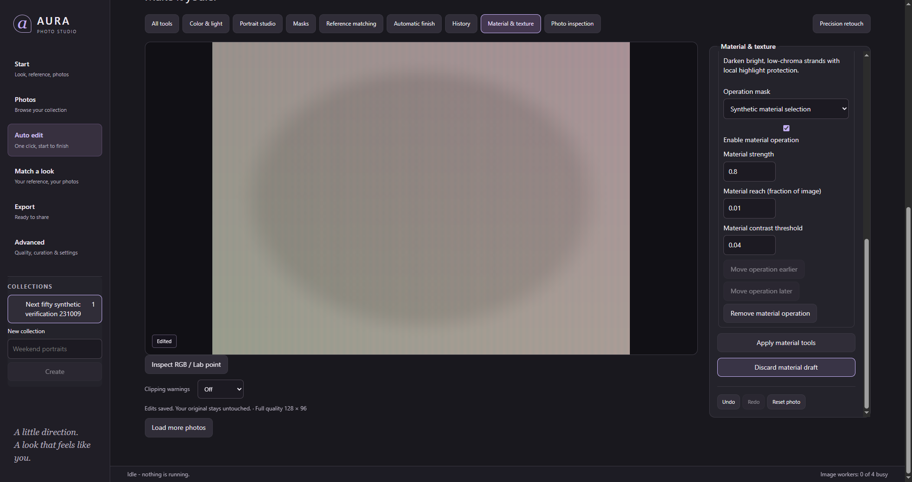
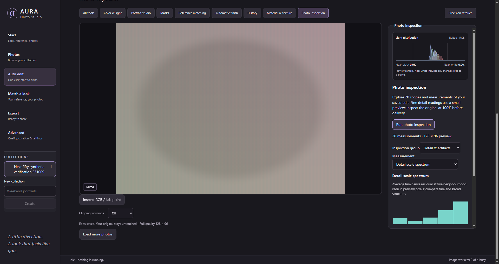
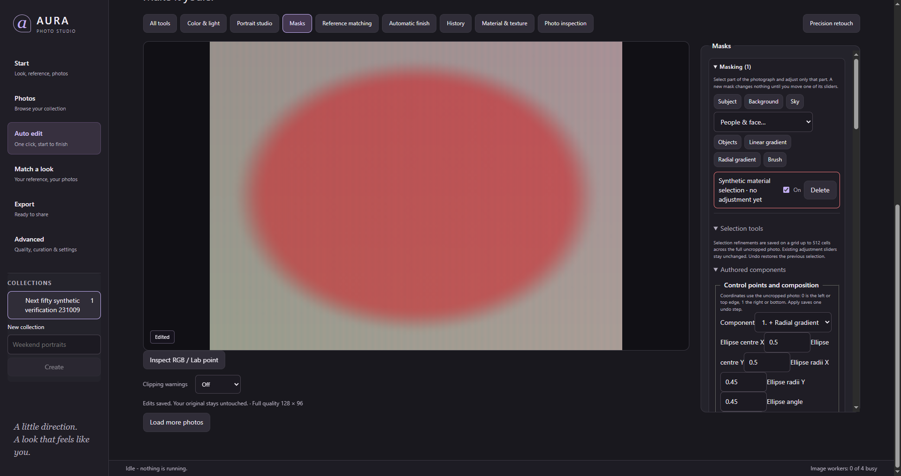

# Fifty further AURA capabilities

Date: 2026-10-20. These additions continue the [earlier fifty](AURA-fifty-capabilities-2026-10-20.md); those existing tools are excluded from this count. Two additional editor panels expose materials and inspection, and Masks gains component authoring and topology sections. Panels, sliders, channels, presets, resets and stack-management buttons are not counted as separate capabilities.

The [fresh REA evidence](AURA-Evoto-next-evidence-2026-10-20.md) binds the installed Evoto 8 worker/GUI by hash, records native diagnostic links, and distinguishes observation from inference. This is a bounded investigation. Complete proprietary algorithms, model weights, training data and exact photographic equivalence were not recovered or established. Several additions are original AURA extensions rather than claimed Evoto features.

## Material editing: 15

The [material guide](../material-and-texture-lab.md) describes methods, controls and limitations. Recipe, native renderer, atomic application command and UI are implemented in the respective `material_lab`, `material_commands` and `MaterialLabPanel` modules.

| # | Additional capability |
| --- | --- |
| 1 | Directional hair smoothing |
| 2 | Silver/white hair darkening with local highlight protection |
| 3 | Joint independent fine/coarse fabric frequency balance |
| 4 | Directional luminance moiré notch |
| 5 | Contrast-gated flat-area debanding |
| 6 | Selected median chroma repair |
| 7 | Isolated impulse-pixel repair |
| 8 | Directional thin-line scratch repair |
| 9 | Row/column stripe-bias repair |
| 10 | Two-pixel checkerboard offset suppression |
| 11 | Explicit edge-ringing repair |
| 12 | Surrounding-diffuse specular chroma reconstruction |
| 13 | Intermediate-scale chroma mottle removal |
| 14 | Selected planar backdrop illumination leveling |
| 15 | Shared-residual cross-channel detail reconstruction |

Items 1–5 extend observed/documented material categories using independent methods. Items 6–15 are AURA restoration extensions. Existing frequency separation and denoising are not presented as new inventions: these are additional selected repair mechanisms and controls. Every operation requires an explicit mask, uses selected-only kernel samples, preserves excluded pixels, and is reversible. There is no new trained model or automatic anatomical classifier.

## Selection authoring: 15

The [selection guide](../mask-authoring-topology-workflows.md) records all fifteen operations and the existing matte-grid/coordinate limits. The existing native `mask_workflow` command carries the additional actions.

| # | Additional capability |
| --- | --- |
| 16 | Edit existing linear-gradient control points |
| 17 | Edit existing radial-gradient geometry and falloff |
| 18 | Edit stored brush strokes, points and pressure |
| 19 | Edit existing luminance-range endpoints and softness |
| 20 | Change an existing component's compositing mode |
| 21 | Reorder component composition |
| 22 | Extract a component into an independent mask with local settings |
| 23 | Copy a component into another existing mask |
| 24 | Affine placement of a completed selection |
| 25 | Derive a selection boundary band |
| 26 | Retain the largest connected selection region |
| 27 | Isolate a seed-connected selected region |
| 28 | Median cleanup of selected/unselected speckles |
| 29 | Symmetric difference of two completed selections |
| 30 | Convex-hull selection fill |

The source editors complete documented editing categories. Topology tools are AURA extensions and do not imply Evoto implements these same algorithms. Copying/extracting components differs from the previous whole-mask duplicate workflow. Largest/seed-connected extraction differs from the previous small-island area cleanup. Boundary bands and median/hull operators produce distinct outputs rather than renamed feather/expand controls.

## Photo inspection: 20

The [inspection report](AURA-photo-inspection-2026-10-20.md) describes computed outputs, coordinate domains and preview limits. Run inspection explicitly on the saved photo revision; it never applies an edit.

| # | Additional capability |
| --- | --- |
| 31 | RGB parade |
| 32 | Horizontal luminance waveform |
| 33 | Opponent-chroma vectorscope |
| 34 | Spatial exposure-zone map |
| 35 | Spatial working-range excursions |
| 36 | Spatial edge-detail map |
| 37 | Flat-area noise-residual map |
| 38 | Near-neutral channel balance measurement |
| 39 | Local contrast map |
| 40 | Rendered percentile tonal-range report |
| 41 | Fifteen-zone exposure distribution |
| 42 | Pre-display sRGB gamut occupancy |
| 43 | Joint row/column banding profile |
| 44 | Eight-pixel block-boundary profile |
| 45 | Edge-direction energy distribution |
| 46 | Relative illumination map |
| 47 | Neutral-edge channel alignment |
| 48 | Channel correlation report |
| 49 | Multiscale detail spectrum |
| 50 | Highlight chroma retention report |

These twenty inspection tools are original AURA extensions. They compute distinct outputs rather than changing pixels. They do not duplicate the existing display histogram, clipping preview or point inspector. Diagnostics use a maximum 512-pixel rendered preview; resampling and scene content affect artifact/detail measurements. They do not prove native-resolution defects, clipped detail recovery, trained skin quality, or Evoto parity.

## Verification

Final source checks pass:

- Frontend: **891 tests across 107 files**, TypeScript and production build.
- Native libraries: **320 app, 80 recipe, 269 renderer tests**; five optional cases ignored.
- Native workflows: **six tests**, including saved material pixels, source preservation, stale writes, exact Undo/Redo, catalogue reopening, unchanged inspection history, and existing selected-material/colour/export regressions. One optional real-RAW case remains ignored.
- Strict Clippy for all targets of app, recipe and renderer; workspace/desktop formatting; diff and banned-pattern checks; **83 unchanged locked contracts**; native IPC definition/registration/invocation counts agree at **344**. Three Python regression tests check unique registration and rejection of duplicate definitions/registrations.

Focused tests exercise each material operator's pixel effect, neutral defaults, determinism, fractional mask strength, excluded pixels and selected-only kernel inputs. They also check that detail and contrast controls change channel reconstruction, including dark/HDR and degenerate selections. Mask tests exercise all fifteen new actions and topology/geometry outputs. Inspection tests exercise bounded finite output, invalid input, known charts and unchanged pixels. UI tests cover authoring, same-revision draft retention, panel switching, revision invalidation, navigation and native failures.

Early verification corrected a ringing fixture that lacked an actual edge, an incomplete mocked IPC error, two native fixture assumptions about appended history and catalogue locking, the channel-detail control cancellation, and equivalent-revision draft replacement. The desktop compiler also caught a collision with the existing `photo_analysis` command. The new command is named `inspect_photo_diagnostics`, and the IPC gate now rejects duplicate definitions and registrations instead of silently deduplicating them. Strict-lint fixes refactored kernels and report construction rather than weakening production checks. Diagnostic logs remain under `.work-checks/evoto-next/`, including failed attempts; final source results are `native-tests.log`, `native-workflows-clean.log`, `clippy-pass.log`, `ui-tests-final.log`, `ui-build-command-fix.log` and `contracts.log`. The frontend build retains its existing large-chunk advisory.

Design: [ADR-0133](../adr/ADR-0133-material-lab-selection-authoring-and-photo-inspection.md). Real portrait cohort qualification, paired Evoto export comparisons and performance on the three reference machines remain unmeasured. This report makes no full-clone or superiority claim.

## Rebuilt Windows desktop

The custom-protocol Windows desktop builds successfully with production frontend
assets. The GNU linker retains the existing resource-manifest merge warning;
it does not prevent launching or running the checks. The executable is
`target/desktop-launch/debug/aura-desktop.exe`, used by `Start AURA.cmd`.

An isolated catalogue with a generated 128 × 96 chart passes **10 desktop smoke
checks**: material UI saving changes native full-quality pixels; unsaved material
drafts survive panel switching; all twenty inspection outputs are reachable;
inspection retains the saved recipe revision; Undo restores exact original
rendered pixels; Redo restores exact edited pixels; authored mask controls are
reachable; stale inspection revisions are refused; imported source bytes remain
identical; and the webview raises no page exceptions. The test closes only its
own isolated desktop process.

Results and screenshots are retained under
`.work-checks/evoto-next/desktop-smoke/`; build evidence is
`desktop-build-final.log`. The [machine-readable ledger](AURA-next-fifty-capabilities-2026-10-20.json)
retains the checks, source digest and rebuilt executable digest. These synthetic
fixtures verify mechanics and UI/native connectivity, not portrait quality.

