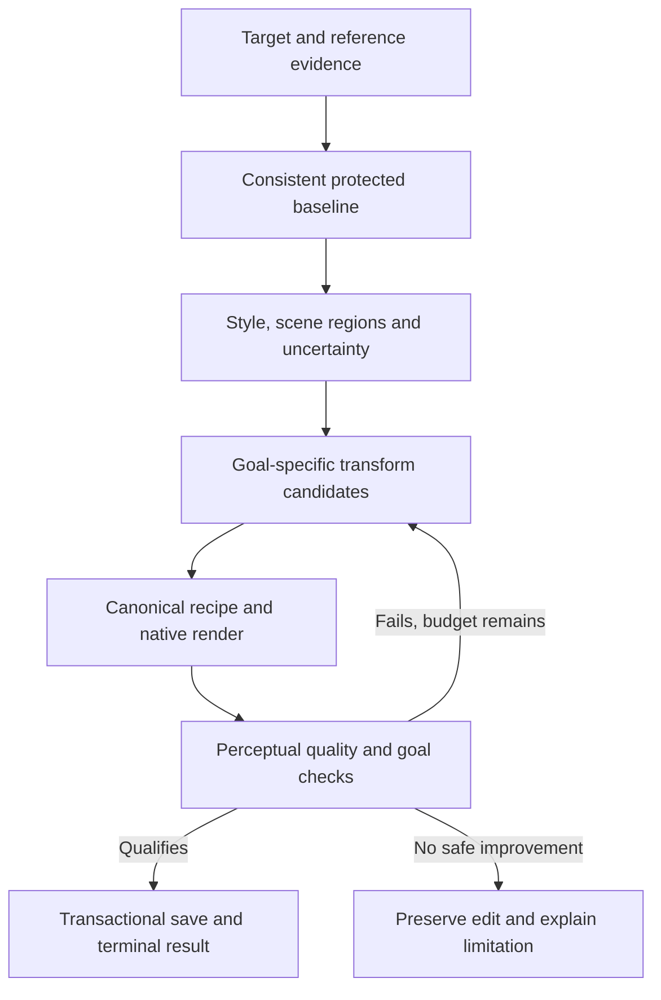

# AURA reference look and colour matching: deep assessment and improvement plan

Date: 2026-10-25. Status: completed. The running Windows desktop was tested on 20 real targets against six reference looks through three matching paths, for 360 distinct combinations. The final saved states of all 20 photos also passed exact pixel checks after a fresh application restart.

Follow-up: [first quality fixes and their validation](AURA-reference-match-quality-fixes-2026-10-25.md). The measurements below remain the original assessment of the recorded executable, before those fixes.

## Finding

**The software can import, apply, save, preview and export matches, but reference look/colour matching is not consistently correct. Passing its native acceptance checks does not certify that the result looks like the reference, preserves natural object colours, or has smooth gradients.**

The running desktop app reproduced the reported mismatch. It also accepted visible colour banding in a desert sky and blotchy colours on a portrait's pale floor. These are photographic quality failures, even though the internal reference-distance objective improved. Natural mode sometimes refuses a requested result or produces no change. Its weaker transfer can preserve a scene better while failing to reproduce the reference treatment.

This report distinguishes measurements, direct visual observations, explanations supported by the implementation, and proposed work. Proposed fixes and research models have not been implemented or qualified by this assessment.

## Evidence and reproducibility

- [Completed 20-photo desktop gallery](../../output/aura-main-match-twenty-2026-10-25/run-988159e9/index.html): 60 initial attempts, with before, reference, saved output and declared known edit.
- [Desktop measurements and integrity checks](../../output/aura-main-match-twenty-2026-10-25/run-988159e9/results.json).
- [Full cross-reference gallery](../../output/aura-main-match-twenty-2026-10-25/run-988159e9/matrix/index.html), [matrix measurements](../../output/aura-main-match-twenty-2026-10-25/run-988159e9/matrix/results.json), [all pair measurements as CSV](../../output/aura-main-match-twenty-2026-10-25/run-988159e9/matrix/pairs.csv). The matrix is complete; every combination and native refusal is retained.
- [Photo provenance, dimensions, byte/pixel hashes and duplicate screening](../../output/aura-twenty-color-match-2026-10-24/dataset/manifest.json).
- [Desktop test harness](../../scripts/test-main-match-twenty.py), [cross-reference test harness](../../scripts/test-reference-match-matrix.py).

Tested executable: `target/desktop-launch/debug/aura-desktop.exe`, SHA-256 `F1318CF2527355FCC26278B1C4F910BE489445DEC4FF226F0C6D0AFE9A5D6369`. Application source and executable were held constant during this assessment. Changes in this turn add testing/reporting, not a new matching algorithm.

The first harness launches the actual native Windows application with an isolated catalogue and WebView2 profile. The single-photo cases click the real Natural/Palette controls; collection cases invoke the same native reference commands used by the collection workflow. Matching and rendering are not mocked. The extended matrix retains those cases and calls the native commands for additional pairs in an isolated SQLite backup, rebuilding its external reference caches from the same edited files. Each new pair resets the target and verifies its native baseline or its baseline recipe. A test harness error originally missed an alert outside the matching panel; the run was resumed after correcting error collection. Completed cases and the original refusal screenshot were retained.

Forty initial attempts exercise single-photo GUI buttons. The other 320 matrix combinations use the native commands through the desktop's real WebView/IPC. The test build implements `AURA_TEST_CATALOG` for isolated debug execution. Reproduction uses the recorded executable and locally cached dataset:

```powershell
python scripts/test-main-match-twenty.py
python scripts/test-reference-match-matrix.py output/aura-main-match-twenty-2026-10-25/run-988159e9
python scripts/report-reference-match-matrix.py output/aura-main-match-twenty-2026-10-25/run-988159e9/matrix
```

The first command creates a new run ID; substitute that printed path in the next two commands for a new assessment. A completed matrix can regenerate its analysis tables/contact sheets without changing matching results.

Inputs are 20 distinct real JPEG photographs with long edge at most 960 pixels. Full/native resolution here means every pixel of those imported assessment images. This is not a 24–64 MP camera/RAW/HDR qualification. Six different source photographs supply six declared reference edits: warm matte, cool cyan, teal/orange split tone, pastel, warm punch and monochrome. No target is its own reference. The unpaired matcher receives only the edited reference, never the declared edit parameters, unedited reference or target oracle.

Published source photographs may already contain edits. The controlled oracle tests the additional declared grade, not recovery of the source photographer's entire processing pipeline. A literal match to every colour proportion of a green forest would also conflict with preserving a pale studio scene's object colours. That intent conflict is distinct from the objectively visible new bands and patches.

| Reference look | Actual reference subject | Manifest photo ID | Additional declared treatment |
|---|---|---:|---|
| Warm matte | Older man wearing a flat cap | 13822354 | Reduced saturation, warm channel gains, gentle curve and lifted black level |
| Cool cyan | Green forest stream | 12779583 | Cooler channel balance, reduced saturation, darker curve and cyan shadow offset |
| Teal/orange | Assorted fruit bowls | 1652312 | Luminance-dependent cool shadows/warm highlights and extra contrast |
| Pastel | Woman in a white top | 33202132 | Lifted/desaturated tone curve and small warm/magenta bias |
| Warm punch | Red cafe and striped awning | 34704802 | Increased saturation/contrast with warm channel balance |
| Monochrome | Studio portrait | 23891642 | Encoded-sRGB luminance conversion with a contrast adjustment |

There is one source photograph per declared look. Reference subject and look family are therefore confounded in this experiment. The matrix can establish failures and identify working combinations in these files; it cannot isolate a universal advantage for one look family or prove a population-wide photo-type rule. Multiple distinct references carrying each identical grade are needed for that stronger conclusion.

All requests use 80% strength. Natural and Palette use Precise mode, with tone, colour and white-balance controls at 100%. The collection workflow includes automatic correction before its reference transform; the studio modes use their own native baseline. Their before images and known-edit expectations are measured separately. Results compare complete workflows, not identical-input algorithm replacements.

## What “match” means in this report

| Check | Question it answers | What it cannot establish |
|---|---|---|
| Native acceptance | Did the engine's own objective and sampled safeguards allow saving? | Correct photographic style or absence of every artifact |
| Independent colour quantiles | Did five CIE Lab a/b quantiles get closer to the reference? | Which object should have each colour, or whether the original edit was recovered |
| Joint colour distance | Did 32 signed projections of 2,048 stratified native a/b samples get closer? | Spatial/semantic correspondence or lighting reproduction |
| Known-edit error | Does the result resemble the declared edit applied to this target's baseline? | Exact unknown photographer intent or all possible meanings of “look” |
| Visual inspection | Are there obvious bands, patches, casts, lost colour relationships or excessive changes? | Exhaustive artifact freedom at every pixel and scale |
| Save/export integrity | Do native preview, saved render, delivery and unchanged source bytes agree? | Whether the chosen edit is aesthetically right |

The known 80% oracle blends baseline and fully declared edit in encoded sRGB. AURA interpolates model parameters; these operations are not identical. Mean CIE76 ≤3 and p95 ≤8 are authored “close known edit” QA thresholds, not a universal perceptual law. A close reference-colour/tone result additionally requires colour quantile distance ≤3, tone distance ≤3 and joint colour distance ≤2. These are separate labels. A result already close before matching can remain close without the matcher accomplishing anything; changed-only counts must be inspected separately. No distance reduction is reported as a percentage of overall accuracy.

The declared monochrome operation uses encoded-RGB luminance, while AURA's grade operates through perceptual colour components and tone curves. Different desaturation/channel-mix definitions can produce different grey brightnesses even without a spatial defect. Consequently, failure of this known-operation threshold does not establish that every monochrome result is an invalid artistic choice. The separately demonstrated new bands, patches and mismatched treatment remain independent quality findings.

## Completed initial desktop assessment

Each target received one cyclically assigned reference in each of three workflows. All 20 inputs were then exported per workflow, yielding 60 verified PNG deliveries. Refused fits export the preserved baseline; this does not count as a successful match.

| Workflow | Attempts | Changed pixels | Safely refused | Independent colour improved | Joint colour improved | Closer to declared edit | Close known edit, all outcomes |
|---|---:|---:|---:|---:|---:|---:|---:|
| Collection reference | 20 | 20 | 0 | 19 | 19 | 12 | 1 |
| Single-photo Natural | 20 | 15 | 3 | 15 | 15 | 14 | 3 |
| Single-photo Palette | 20 | 20 | 0 | 19 | 19 | 10 | 0 |

One of Natural's three close outcomes was an unchanged image (target 17), so it is not evidence of a successful transfer. Its refused targets were 11, 13 and 20; targets 17 and 19 were accepted without changing pixels. Median measured fit/apply times were approximately 3.30 s for collection, 2.09 s for Natural and 4.41 s for Palette. These exclude much of the import, rendering, UI navigation and export work and do not predict full-resolution camera performance.

All initial cases preserve source/reference byte hashes. Native full previews equal full export-purpose renders pixel for pixel. All 60 deliveries equal the corresponding saved renders. One changed case per workflow passes native undo/redo with exact baseline/matched pixel restoration. No JavaScript page errors were recorded. Those are workflow integrity results; they do not overturn the quality failures.

## Full matrix results

All counts below use the completed 360-case matrix at 80% requested strength. Close known results use the declared mean/p95 QA thresholds and the interpolation caveat explained in the report. Changed-close excludes refused and unchanged results.

| Workflow | Attempts | Refused | Changed | Reference colour improved | Joint colour improved | Close reference colour + tone | Known edit closer | Close known / changed-close / newly close | Exact known | Median known error |
|---|---:|---:|---:|---:|---:|---:|---:|---:|---:|---:|
| collection | 120 | 0 | 117 | 112 | 114 | 4 | 64 | 6 / 6 / 6 | 0 | 7.504 |
| natural | 120 | 13 | 101 | 93 | 95 | 0 | 86 | 18 / 16 / 13 | 0 | 5.212 |
| palette | 120 | 0 | 120 | 117 | 118 | 3 | 54 | 4 / 4 / 4 | 0 | 9.210 |

Newly close requires a changed accepted result that passes the known-edit thresholds when its own baseline did not. A result that was already close before matching is not counted as newly successful.

### Results by requested look

| Look | Workflow | Refused / 20 | Close reference colour + tone / 20 | Known edit closer / 20 | Changed-close / newly close known | Median known error |
|---|---|---:|---:|---:|---:|---:|
| warm-matte | collection | 0 | 0 | 13 | 1 / 1 | 6.371 |
| warm-matte | natural | 4 | 0 | 12 | 0 / 0 | 5.204 |
| warm-matte | palette | 0 | 0 | 12 | 2 / 2 | 6.895 |
| cool-cyan | collection | 0 | 1 | 8 | 0 / 0 | 9.865 |
| cool-cyan | natural | 3 | 0 | 16 | 1 / 1 | 6.376 |
| cool-cyan | palette | 0 | 0 | 7 | 0 / 0 | 11.258 |
| teal-orange | collection | 0 | 0 | 6 | 2 / 2 | 4.744 |
| teal-orange | natural | 1 | 0 | 12 | 5 / 4 | 3.501 |
| teal-orange | palette | 0 | 0 | 4 | 1 / 1 | 5.263 |
| pastel | collection | 0 | 1 | 13 | 0 / 0 | 9.163 |
| pastel | natural | 2 | 0 | 14 | 0 / 0 | 8.276 |
| pastel | palette | 0 | 1 | 12 | 1 / 1 | 9.961 |
| warm-punch | collection | 0 | 0 | 11 | 0 / 0 | 8.160 |
| warm-punch | natural | 3 | 0 | 13 | 1 / 0 | 7.164 |
| warm-punch | palette | 0 | 0 | 9 | 0 / 0 | 9.645 |
| monochrome | collection | 0 | 2 | 13 | 3 / 3 | 8.473 |
| monochrome | natural | 0 | 0 | 19 | 9 / 8 | 3.152 |
| monochrome | palette | 0 | 2 | 10 | 0 / 0 | 8.128 |

### Results by photo type

Repeated references/modes on one photograph are correlated observations. A category containing one or two photographs does not establish a general capability for that category.

| Type | Distinct photos | Attempts | Refused | Reference colour improved | Changed-close / newly close known | Median known error |
|---|---:|---:|---:|---:|---:|---:|
| Architecture | 1 | 18 | 0 | 17 | 0 / 0 | 9.754 |
| Flowers / bright background | 1 | 18 | 0 | 18 | 1 / 1 | 12.473 |
| Food | 2 | 36 | 0 | 35 | 0 / 0 | 11.552 |
| Landscape | 4 | 72 | 0 | 71 | 4 / 4 | 9.541 |
| Night city | 1 | 18 | 1 | 17 | 1 / 1 | 8.143 |
| Portrait / daylight | 1 | 18 | 0 | 18 | 1 / 1 | 5.833 |
| Portrait / dramatic light | 2 | 36 | 3 | 31 | 1 / 1 | 5.955 |
| Portrait / monochrome | 1 | 18 | 1 | 9 | 3 / 1 | 4.536 |
| Portrait / night | 2 | 36 | 0 | 32 | 2 / 2 | 6.150 |
| Portrait / soft light | 1 | 18 | 1 | 17 | 4 / 4 | 6.468 |
| Portrait / studio | 4 | 72 | 7 | 57 | 9 / 8 | 5.643 |

### Every tested photograph: successful and unsuccessful combinations

Each photo has 18 combinations. A listed changed-close case is a measured candidate, not a certification of all local details. “No changed-close” means none of the six tested looks and three modes passed that criterion on this photo, not that every possible future reference must fail.

| Photo | Type / subject | Changed-close / 18 | Best changed accepted case: mean / p95 error | Worst accepted changed case: mean error |
|---:|---|---:|---|---|
| 01 | [Night portrait with flash](../../output/aura-main-match-twenty-2026-10-25/run-988159e9/matrix/photo-01.jpg) | 0 | collection/monochrome: 3.128 / 5.191 | collection/warm-punch: 8.523 |
| 02 | [Illuminated waterfront skyline](../../output/aura-main-match-twenty-2026-10-25/run-988159e9/matrix/photo-02.jpg) | 1 | natural/monochrome: 2.310 / 3.271 | palette/monochrome: 18.018 |
| 03 | [Cafe, brick and red flowers](../../output/aura-main-match-twenty-2026-10-25/run-988159e9/matrix/photo-03.jpg) | 0 | natural/teal-orange: 3.602 / 6.718 | palette/monochrome: 25.819 |
| 04 | [Person on beach at night](../../output/aura-main-match-twenty-2026-10-25/run-988159e9/matrix/photo-04.jpg) | 2 | palette/warm-matte: 2.674 / 6.077 | palette/monochrome: 26.407 |
| 05 | [Beach at dusk / backlight](../../output/aura-main-match-twenty-2026-10-25/run-988159e9/matrix/photo-05.jpg) | 1 | natural/monochrome: 1.622 / 3.814 | palette/warm-punch: 9.931 |
| 06 | [Red flowers in snow](../../output/aura-main-match-twenty-2026-10-25/run-988159e9/matrix/photo-06.jpg) | 1 | natural/teal-orange: 2.347 / 4.456 | collection/warm-matte: 19.655 |
| 07 | [Mossy forest waterfall](../../output/aura-main-match-twenty-2026-10-25/run-988159e9/matrix/photo-07.jpg) | 0 | natural/monochrome: 3.149 / 4.606 | collection/monochrome: 21.943 |
| 08 | [Autumn forest waterfall](../../output/aura-main-match-twenty-2026-10-25/run-988159e9/matrix/photo-08.jpg) | 1 | collection/teal-orange: 2.567 / 5.231 | palette/monochrome: 23.824 |
| 09 | [Desert and smooth sky](../../output/aura-main-match-twenty-2026-10-25/run-988159e9/matrix/photo-09.jpg) | 2 | natural/monochrome: 1.814 / 4.877 | collection/warm-punch: 18.561 |
| 10 | [Older man outdoors](../../output/aura-main-match-twenty-2026-10-25/run-988159e9/matrix/photo-10.jpg) | 1 | collection/monochrome: 2.780 / 4.415 | natural/pastel: 8.280 |
| 11 | [Bearded man, high contrast](../../output/aura-main-match-twenty-2026-10-25/run-988159e9/matrix/photo-11.jpg) | 1 | natural/monochrome: 2.210 / 3.512 | palette/monochrome: 7.160 |
| 12 | [Older man, close soft-lit portrait](../../output/aura-main-match-twenty-2026-10-25/run-988159e9/matrix/photo-12.jpg) | 4 | natural/monochrome: 0.881 / 1.710 | palette/cool-cyan: 10.571 |
| 13 | [Already black-and-white portrait](../../output/aura-main-match-twenty-2026-10-25/run-988159e9/matrix/photo-13.jpg) | 3 | natural/monochrome: 1.782 / 4.831 | palette/warm-punch: 6.010 |
| 14 | [Bright fruit close-up](../../output/aura-main-match-twenty-2026-10-25/run-988159e9/matrix/photo-14.jpg) | 0 | natural/teal-orange: 3.490 / 6.026 | collection/warm-punch: 23.272 |
| 15 | [Fruit in low light / bokeh](../../output/aura-main-match-twenty-2026-10-25/run-988159e9/matrix/photo-15.jpg) | 0 | collection/teal-orange: 3.158 / 6.851 | palette/monochrome: 27.228 |
| 16 | [White corset, warm studio light](../../output/aura-main-match-twenty-2026-10-25/run-988159e9/matrix/photo-16.jpg) | 4 | natural/monochrome: 2.579 / 4.229 | collection/monochrome: 9.046 |
| 17 | [Dim studio and dark curtain](../../output/aura-main-match-twenty-2026-10-25/run-988159e9/matrix/photo-17.jpg) | 4 | natural/cool-cyan: 1.687 / 7.907 | palette/cool-cyan: 7.205 |
| 18 | [Red studio illumination](../../output/aura-main-match-twenty-2026-10-25/run-988159e9/matrix/photo-18.jpg) | 0 | natural/teal-orange: 3.088 / 7.105 | collection/pastel: 16.264 |
| 19 | [Studio portrait with natural hair](../../output/aura-main-match-twenty-2026-10-25/run-988159e9/matrix/photo-19.jpg) | 0 | natural/monochrome: 4.162 / 7.416 | collection/pastel: 10.454 |
| 20 | [Pastel dress and pale floor](../../output/aura-main-match-twenty-2026-10-25/run-988159e9/matrix/photo-20.jpg) | 1 | natural/monochrome: 1.718 / 2.572 | collection/cool-cyan: 19.863 |

### Smooth-sky diagnostics across all reference looks

| Workflow | Look | Adjacent-step p99 before / after | Maximum before / after | Pairs changing from ≤1 to >3 |
|---|---|---:|---:|---:|
| collection | teal-orange | 1.857 / 6.844 | 4.374 / 21.527 | 7149 / 451012 |
| natural | teal-orange | 1.860 / 1.970 | 4.374 / 4.638 | 0 / 451012 |
| palette | teal-orange | 1.860 / 1.979 | 4.374 / 4.881 | 0 / 451012 |
| collection | warm-matte | 1.857 / 2.705 | 4.374 / 8.158 | 1 / 451012 |
| collection | cool-cyan | 1.857 / 6.690 | 4.374 / 22.160 | 11989 / 451012 |
| collection | pastel | 1.857 / 1.433 | 4.374 / 4.301 | 0 / 451012 |
| collection | warm-punch | 1.857 / 7.398 | 4.374 / 22.844 | 8666 / 451012 |
| collection | monochrome | 1.857 / 1.714 | 4.374 / 4.713 | 0 / 451012 |
| natural | warm-matte | 1.860 / 1.885 | 4.374 / 4.708 | 0 / 451012 |
| natural | cool-cyan | 1.860 / 1.969 | 4.374 / 5.042 | 0 / 451012 |
| natural | pastel | 1.860 / 1.873 | 4.374 / 4.358 | 0 / 451012 |
| natural | warm-punch | 1.860 / 1.979 | 4.374 / 5.488 | 0 / 451012 |
| natural | monochrome | 1.860 / 1.443 | 4.374 / 3.308 | 0 / 451012 |
| palette | warm-matte | 1.860 / 3.484 | 4.374 / 13.143 | 69 / 451012 |
| palette | cool-cyan | 1.860 / 6.920 | 4.374 / 23.332 | 13255 / 451012 |
| palette | pastel | 1.860 / 1.434 | 4.374 / 4.303 | 0 / 451012 |
| palette | warm-punch | 1.860 / 5.292 | 4.374 / 15.114 | 5145 / 451012 |
| palette | monochrome | 1.860 / 1.745 | 4.374 / 4.370 | 0 / 451012 |

### What the complete matrix supports

Across all 360 combinations, 322 improved independent reference-colour quantiles and 327 improved joint colour distance, yet only seven met the declared close reference-colour-plus-tone thresholds. There were 28 close known-edit outcomes, 26 of which changed pixels; only 23 newly crossed into close from a baseline that was not already close. None was pixel-exact to the declared oracle. These figures are separate criteria, not overall accuracy percentages.

The collection workflow produced six newly close results; Natural produced 13; Palette produced four. Natural also refused 13 requests at its native gate, preserving the saved baseline each time. Nine total non-refused cases left the image unchanged. The stronger Palette path cannot be called better merely because it improves reference colour in 117 of 120 cases: it brought the known edit closer in only 54 and newly close in four.

- **Working combinations exist:** soft-lit portrait 12 with monochrome or teal/orange in collection/Natural; studio portrait 16 with warm matte in collection/Palette; night beach portrait 4 with warm matte in Palette or teal/orange in Natural; desert 9 with restrained Natural teal/orange/monochrome; autumn forest 8 with collection teal/orange. Each is a specific reference/goal/target result.
- **Monochrome is relatively stronger in Natural:** nine changed-close outcomes, eight newly close, versus three newly close in collection and zero in Palette. This does not prove that every black-and-white request works or that Natural is best for every other look.
- **No changed-close result occurred in any of the 18 combinations** for targets 1 (night flash portrait), 3 (cafe/brick), 7 (mossy forest), 14 and 15 (both food scenes), 18 (red-lit portrait), or 19 (studio portrait with natural hair). This is seven tested photographs, not a proof that those entire subject categories can never match. Some of their best results were near the threshold.
- **Food was particularly weak here:** neither food target achieved changed-close across 36 combinations, despite 35 improving reference colour and all 36 improving joint colour. Similar content alone is insufficient: the teal/orange reference is itself food.
- **Warm punch was weak for this particular reference:** no newly close outcome across its 60 combinations. The one Natural changed-close result was already close before matching. A different reference carrying the same grade is needed before attributing this entirely to that grade family.
- **Pale backgrounds and smooth skies require a specific quality fix:** the native-size failures in targets 9 and 20 remain disqualifying even when some other references or modes on those photos pass the known-edit threshold.

The initial 60 deliveries were verified through the native Delivery subsystem. All 360 native full previews equalled export-purpose renders. A fresh desktop restart retained all 20 final saved outputs pixel for pixel and left recipe hashes unchanged. Accepted studio result metadata was checked for the correct reference ID, matching goal and 80% amount in all 227 non-refused studio cases. Thus these observed mismatches cannot be dismissed as merely selecting a reference without applying it. [Restart and reference/control checks](../../output/aura-main-match-twenty-2026-10-25/run-988159e9/matrix/reopen.json).

## Confirmed failures with actual pixels

### 1. Smooth sky becomes visibly banded

Target 9 is a desert landscape with a broad smooth sky; its initial reference is teal/orange fruit. The collection result develops abrupt cyan contours and visible block-like steps. These are absent from its baseline and declared known edit.

- [Baseline](../../output/aura-main-match-twenty-2026-10-25/run-988159e9/09.collection.teal-orange.before.png).
- [Accepted collection result](../../output/aura-main-match-twenty-2026-10-25/run-988159e9/09.collection.teal-orange.matched.png).
- [Declared known edit](../../output/aura-main-match-twenty-2026-10-25/run-988159e9/09.collection.teal-orange.expected.png).

Independent reference-colour distance improves from 34.708 to 29.567 while known-edit mean CIE76 error is 12.393. In the top 45% of the image, excluding five border pixels, adjacent-pixel CIE76 p99 increases from 1.857 to 6.844 and maximum increases from 4.374 to 21.527. There are 7,149 adjacent pairs whose baseline step is ≤1 but output step is >3, among 451,012 checked pairs. This is a diagnostic of amplification in this selected region, not a general image-quality metric. The corresponding Natural result has p99 1.970, maximum 4.638 and zero such amplified pairs in that region, but it transfers much less of the reference palette.

### 2. Pale floor and portrait receive blotchy colour changes

Target 20 is a full-body studio portrait in a pastel dress against a pale floor. The cool/cyan forest reference causes a dark green/cyan cast and large pale-floor colour patches in the collection output. A lower palette distance does not make this a satisfactory portrait match.

- [Baseline](../../output/aura-main-match-twenty-2026-10-25/run-988159e9/20.collection.cool-cyan.before.png).
- [Accepted collection result](../../output/aura-main-match-twenty-2026-10-25/run-988159e9/20.collection.cool-cyan.matched.png).
- [Declared known edit](../../output/aura-main-match-twenty-2026-10-25/run-988159e9/20.collection.cool-cyan.expected.png).

Reference-colour distance improves from 10.264 to 3.966, but known-edit mean CIE76 error is 19.863. Natural refuses this case without editing the recipe. Its refusal is useful protection, but does not satisfy a request to apply that look successfully.

### 3. Reference subject colours are confused with its treatment

The cool forest reference can make bright fruit much darker and less red. In target 14's collection output, reference colour improves 51.814 →35.583 while known-edit mean error is 14.255. The corresponding Palette result's known-edit error is 19.517. The reference has many green/dark pixels because of its subject and lighting; those proportions are not necessarily the intended edit for a bowl of fruit. Conversely, a bright multicoloured food reference can push a landscape's colours into an inappropriate distribution. These are observed output differences and a supported explanation of the global distribution objective, not proof that one single coefficient caused every defect.

### 4. Native and independent metrics can disagree

Target 17 / warm punch / Palette passes native application while independent CIE Lab colour distance worsens 54.259 →54.963; its known-edit mean error is 6.945. The native objective uses OKLab summaries and a different joint-distribution approximation. Its nonregression policy does not mathematically guarantee nonregression under every independent metric. The product should not present that internal acceptance as general photographic correctness.

### 5. Failed save leaves a stale matching message

Natural target 11 / warm punch raises a native refusal, preserves the recipe and reenables the Match button, but still displays “Matching the selected reference to this photo…”. The refusal appears in the outer editor's alert, not inside the matching panel.

[Actual refusal/progress screenshot](../../output/aura-main-match-twenty-2026-10-25/run-988159e9/natural-11-refusal-before-resume.png).

The implementation supports this explanation: [PhotoStudio's write wrapper](../../ui/src/components/develop/PhotoStudio.tsx) catches the rejected save and displays an outer error, then resolves its promise. [ColorMatchPanel's matchNow handler](../../ui/src/components/look/ColorMatchPanel.tsx) awaits that wrapper and retains its earlier matching message when its success callback never runs. Error reporting and progress ownership therefore disagree. This is a UI state bug, distinct from the native safety refusal.

## Photo types: supported cases, weak cases and unsupported expectations

These are bounded observations on these photographs and the current implementation. The final per-photo matrix below supplies the measured combinations; a subject label alone cannot decide success.

| Photo/reference situation | What the present code can do | Where it fails or remains unqualified |
|---|---|---|
| Soft-lit close portrait with a restrained or monochrome global reference | Target 12 / monochrome is close to the declared edit in collection and Natural in the initial run | Other references on that portrait can still miss tone/cast; a face match is not a promise to reproduce another person's lighting |
| Studio portrait with compatible gentle warmth | Collection target 16 / warm matte qualifies as changed-close in the expanded run | The same target / pastel did not qualify initially; studio portraits are not universally supported as one class |
| A landscape with restrained colour adaptation | Natural target 9 / teal-orange stays close to the declared edit and avoids the severe sky bands seen in collection | Stronger palette transport can posterize the very same sky; no entire landscape class can be marked safe |
| Forest/foliage with a related palette | Some combinations improve colour resemblance; collection target 8 / teal-orange is a changed-close example in the expanded run | Matching a forest subject does not necessarily recover its grade; different seasonal foliage/lightness proportions still confound distributions |
| Night portraits or city lights | The engine can apply bounded global changes and preserve/export the image | Strong cast, light source colours, flash-lit skin and dark backgrounds are difficult to disentangle; city/forest combinations can develop inappropriate green/cyan casts |
| Bright food or saturated objects | A related food reference can produce plausible restrained colour changes | Forest-to-fruit transfers can darken/recolour red fruit, even when reference-colour distance improves |
| Pale floors, walls, smooth skies or studio backdrops | Native rendering and export work normally | The current dark-only smoothness guard does not qualify these bright gradients; the sky and floor failures are confirmed |
| Deep shadows and dim studio scenes | Skin/highlight/contour checks can restrict or refuse aggressive changes | A safe no-op or refusal is not a successful look transfer; very weak accepted changes may leave the reference visibly unmatched |
| An already monochrome source with a colourful reference | Tone can change; grey preservation can avoid invented object colours | The fitter explicitly keeps genuinely grey targets grey for strongly colourful references. It cannot recover the original object's true colours. Intentional tint/sepia needs a distinct, qualified toning goal |
| Same original/same framing, changed only by a global grade | Existing registered and paired native fixtures demonstrate much stronger calibration | The 20-photo unpaired matrix does not prove real-world paired accuracy; crops, local edits, geometry and lighting changes break the calibration assumptions |
| Locally relit, heavily retouched or composited references | A subset of their global colour/tone may be approximated | A shared global grade cannot reproduce subject-specific light placement, masks, makeup, blur, geometry or texture across unrelated scenes |
| Clipped/strongly compressed images, camera RAW/HDR/wide-gamut workflows | Some supported inputs decode and can receive a bounded edit | Lost data cannot be recovered exactly; this JPEG assessment does not qualify all camera pipelines or high-bit-depth output behaviour |

## Why the current implementation misses the reference

### The two visible routes use different fitting policies

The single-photo panel on Match a look is [ColorMatchPanel](../../ui/src/components/look/ColorMatchPanel.tsx), initially Natural/Precise. It uses `import_color_reference`, `prepare_color_match` and `apply_color_match`. The collection/reference workflow exposed through [InstagramStyle](../../ui/src/components/look/InstagramStyle.tsx) uses `analyse_reference_style` and `apply_reference_style`, which enter [adaptive collection fitting](../../crates/aura-app/src/color_match/gallery_fit/adaptive.rs). Both are present in [App](../../ui/src/App.tsx). Improving one path does not automatically replace the other. They also start from different baseline policies. A single “Match a look” label hides material differences in behaviour.

The studio's default amount is 100%; the collection reference selection starts at 80%. This assessment deliberately sets both to 80% for its matrix. It does not establish behaviour at 100%, 150% or 200% on these real photos. Those settings need their own endpoint checks and qualification.

There is also a reference-measurement difference: studio [import_reference](../../crates/aura-app/src/color_match.rs) calls the bounded `reference_image::decode`, whose long edge is 512 pixels, then stores transfer measurements from that reduced image. Collection matching calls `decode_native` and retains native stratified evidence. Fine coloured patterns can therefore still lose their separate colours in the primary single-photo route even though the collection path was improved. This mechanism is confirmed by the code; the present 20 photos are not a dedicated textile qualification.

Fixing that route requires shared native/precision-aware sampling and cache migration, not only changing the decoder call. `transfer::remember` reuses already usable stored statistics. Updating measurement rules without changing their version/key can retain older reduced evidence. Old preview-only references cannot recover missing fine colours; reimport or reliable retained native samples are needed. The report's new matrix uses freshly analysed references and should not be interpreted as qualification of all legacy caches.

### Unrelated colour distributions contain scene content

[GradeStats and distance](../../crates/aura-app/src/color_match/transfer.rs) summarize tone, neutral-axis cast, chroma, hue sectors and optional joint palette evidence. The Palette objective weights its joint palette term as four parts of an eight-part total. Natural excludes that palette term. These descriptors cannot uniquely separate a green forest's material colours from a green editing cast, or a white studio background from a deliberately lifted tone curve. Spatial structure qualifying as the same image can enable stronger registered fitting; unrelated images do not provide that correspondence.

Natural additionally uses an unrelated-scene shrink factor of 0.5 outside its corresponding/monochrome/toned branches. Palette enables stronger distribution fitting. Thus increasing the amount slider in Natural is not equivalent to choosing Palette. The fitter's internal `corresponding()` helper also includes Palette mode to enable that fitting policy; it should not be read as proof of real spatial correspondence. Registered pixel fitting has separate structure checks.

The collection adaptive selector measures unrelated candidates against palette-enabled reference statistics. More flexible colour transport can score better without being the most natural or faithful edit. Selecting the lowest summary distance therefore needs semantic and spatial quality constraints, not only a larger candidate family.

### Smoothness protection has a specific blind spot

[Contours](../../crates/aura-app/src/color_match/contours.rs) samples up to 4,096 starting pixels and considers adjacent pairs only when all RGB components of both original pixels are ≤96 and their maximum channel difference is ≤2. It rejects a sufficient fraction of output steps ≥12 and requires at least 128 eligible pairs; insufficient evidence returns acceptance. This helps dark smooth regions. It does not cover the brighter cyan sky or white floor that fail here, nor certify subtle perceptual/chromatic steps everywhere.

The palette map itself uses [continuous bilinear interpolation](../../crates/aura-render/src/reference_grade/palette.rs), and [tone/quantile fitting](../../crates/aura-app/src/color_match/transfer.rs) already has regularization. It would be inaccurate to blame these artifacts on a nearest-neighbour LUT or complete absence of smoothing. The observed failure shows that the composed transform, gamut/precision path and current safeguards still allow visible amplification. Exact attribution among those components requires controlled ablations.

Palette refinement composes multiple bounded projected quantile updates before baking the map. Bounding one update's slope does not tightly bound the composed mapping's colour amplification. Likewise, continuity at lattice-cell borders does not guarantee a sufficiently small derivative for an 8-bit JPEG gradient. The complete operation must be probed and constrained after composition, skin protection and gamut handling.

### Sampled skin preservation is not full scene quality

[Appearance analysis](../../crates/aura-app/src/color_match/appearance.rs) checks supported pooled and per-person skin regions. It does not match one person's skin to another's, which is appropriate. Protection is bounded by segmentation support and authored aggregate limits. It does not guarantee correct clothing, walls, sky, food, small faces or every local pixel. A skin-colour heuristic in the renderer also cannot uniquely identify skin by RGB values in all lighting. Increasing its strength cannot solve reference/subject confusion throughout an image.

### There is no unique edit to recover from one arbitrary edited photo

The same final photograph could result from different original illumination, object colours, camera processing and editing operations. A single unrelated reference does not contain those missing originals. A reference with local relighting, masks, blur, texture, makeup or retouching also asks for operations outside a shared global colour transform. More parameters alone can fit the wrong scene distribution more strongly. Better priors, semantic evidence and additional references can improve the estimate, but cannot create a guarantee of exact recovery from absent information.

The current [reference decoder](../../crates/aura-app/src/color_match/reference_image.rs) supports JPEG/PNG/TIFF references, bounded to 256 MB and 64 MP, with supported ICC conversion. Its analysis result is RGB8, including when a higher-bit-depth file was decoded. Native reference dimensions therefore do not imply high-precision colour evidence. Preserving floating-point/high-bit-depth evidence is useful future work, but does not by itself solve wrong semantics or an overaggressive composed transform.

## What to fix first

| Priority | Change | Modules | Evidence/acceptance needed |
|---|---|---|---|
| P0 | Reject or reduce new perceptual bands in smooth regions across dark, midtone and bright ranges | `contours.rs`, both native review paths, renderer tests | Desert sky and pale floor failures must be caught at the requested strength; preserve legitimate textured edges |
| P0 | Constrain the composed transform's local colour amplification and quantization sensitivity | tone/cast/hue/palette fitting and `reference_grade` rendering | No amplified plateaus or sharp hue steps on neutral/coloured ramps and real gradients after gamut mapping/export |
| P0 | Resolve stale progress/error ownership | `PhotoStudio.write`, `ColorMatchPanel.run/matchNow` | A refused save produces one terminal refused/error state, clears progress, reenables controls and preserves history |
| P1 | Give both UI entry points a shared fitting/validation contract with explicit goals | `reference_style`, `matcher`, `gallery_fit`, UI IPC | Equivalent inputs/goals/strength/baseline policy give equivalent decisions; intentional goal differences stay explicit |
| P1 | Share native reference sampling and version its stored evidence | studio import, `reference_image`, `transfer::remember`, cache schema | Fine-pattern reference colours survive both routes; old preview-only caches are identified and properly reimported/migrated |
| P1 | Compare compatible semantic/lighting regions instead of forcing whole-image object proportions | appearance/vision, evidence, objective | Forest-to-fruit and forest-to-pale-portrait must not recolour subjects merely to match reference area fractions |
| P1 | Optimize and qualify the actually requested endpoint | studio fit/apply, strength handling | 25/50/80/100% and supported stronger settings independently pass native quality checks or clearly report inability |
| P1 | Separate style resemblance, native safety, and estimated reliability in diagnostics | native reports and UI | No constant confidence or small distance reduction presented as correctness probability |
| P2 | Add a trained reference-conditioned predictor with a constrained editable transform | model inference, training/evaluation, renderer | Improvement on content-disjoint held-out data plus native artifact checks, not just nicer training examples |

### A bounded perceptual gradient check

Measure native baseline noise and texture first. Select smooth regions with edge/texture support across the full lightness range. Compare local lightness and chromatic steps before/after using absolute perceptual change, amplification ratio and affected spatial area. Distinguish real object boundaries from new contours inside smooth surfaces. Add local sample coverage and uncertainty to the review result. Backtrack or choose another candidate when the requested endpoint fails. Do not add blur to hide the artifact or remove the check to obtain a closer palette score.

The current 4,096-pixel budget can remain bounded, but selection should allocate support to large smooth skies, walls, backdrops and floors as well as shadows. A region with insufficient evidence must be marked unqualified rather than described as artifact-free. Thresholds need calibration on textured and smooth held-out images; the selected sky diagnostic above is a regression case, not the universal threshold.

### Bound the complete colour operation

Regularizing one tone curve or interpolating one LUT continuously does not bound the derivative of their composition. Check lightness/cast/hue/palette changes together, including gamut compression. Constrain abrupt neighbour differences and local Jacobian magnitudes in relevant colour regions; retain monotonic tone behaviour where required. Probe dense colour ramps and near-neutral gradients, including repeated/near-flat source quantiles. Preserve high precision during measurement/fitting/rendering where available, and test final 8/16-bit outputs. Dithering can reduce final quantization visibility; it cannot correct wrong casts, clipped detail or a bad transport function.

### Make the matching goal explicit

Keep separate goals for a natural adaptation, stronger palette resemblance, and a learned original/edited global operation. Natural should preserve the target's photographic balance; it cannot simultaneously promise arbitrary reference colour proportions. Palette transfer should explain likely scene mismatch and preserve protected semantic colours. The existing original + edited pair is stronger evidence for a reusable edit when identical framing/global edits are available. It is not the same problem as an arbitrary unrelated edited image, and its benefits need separate qualification on real held-out targets.

## An advanced architecture that addresses these failures



1. **Normalize inputs consistently.** Retain orientation, supported ICC conversion and native colour evidence. Separate optional auto exposure/white balance from the reference operation so it is not counted twice. Preserve a reproducible baseline, manual field protection and one canonical colour-space/render path.
2. **Describe both style and scene support.** Combine global tone/chroma/cast features with confidence-weighted regions for people/skin, sky, foliage, architecture, food, neutral surfaces and background. A region absent or unreliable in either image supplies no semantic correspondence. Do not map unrelated objects just because their hues or pixel counts overlap.
3. **Estimate plausible reusable transforms.** Generate candidates from current Natural/Palette/registered strategies, a calibrated pair when available, and eventually a trained reference-conditioned predictor. Use a monotone tone component plus a smooth constrained 3D colour transform or region-conditioned mixture. Existing palette transport is a 2D chromatic component inside a richer grade; moving to a full 3D model must add useful lightness/colour coupling, not only more degrees of freedom.
4. **Optimize a goal-specific objective.** Balance regional tone/cast/chroma/hue resemblance against source structure, semantic-colour plausibility, identity, smoothness and gamut/precision penalties. Use supported region weights rather than global subject-area equality. Keep distinct objectives for exact paired calibration and unrelated adaptation.
5. **Validate the real endpoint.** Render at requested strength with the exact canonical recipe that will be saved. Check independent colour diagnostics, local gradient/chromatic artifacts, supported individual skin regions, clipping, texture/edge preservation and baseline protection. Compare strategies and backtrack with a bounded budget. If none qualifies, preserve the edit and say why.
6. **Save a transparent decision.** Record which model/goal was used, effective strength, any backtracking, reference/region support, failed gates and measured improvement. Progress has one owner and explicit terminal states. Reference replacement, undo/reset, cancellation and reopen must use the same saved model and baseline.

For reference folders, first check whether the examples actually share one treatment. Separate conflicting style groups instead of averaging them into a muddy compromise. Use diverse subjects with the same look, retain balanced per-photo evidence, and select lighting-conditioned support only when it is adequate. Estimate uncertainty across reference photographs, not as though thousands of correlated pixels were thousands of independent style examples. The current lighting buckets and bounded evidence pool are useful infrastructure, but are not themselves proof of style/content separation.

An implementation contract could use the following terminal outcomes. This is a design sketch, not code already added to the application:

```typescript
type MatchOutcome =
  | { kind: 'saved'; recipeHash: string; model: string;
      requestedStrength: number; appliedStrength: number; diagnostics: MatchDiagnostics }
  | { kind: 'unchanged'; reason: 'already-close' | 'no-safe-improvement'; diagnostics: MatchDiagnostics }
  | { kind: 'refused'; reasons: string[]; diagnostics: MatchDiagnostics }
  | { kind: 'cancelled' }
  | { kind: 'stale'; expectedRecipeHash: string; actualRecipeHash: string };
```

The matching controller should consume that outcome directly. A generic editor error handler must not turn a failed save into a resolved success-shaped promise. The result's saved recipe hash and native diagnostics should identify the exact canonical endpoint. Anticipated refusals and no-ops should have explicit explanations instead of remaining in a “matching” state.

Changing the generic editor wrapper to rethrow would require auditing all its callers, including calls that intentionally discard its promise. An explicit handled result is preferable to introducing unhandled rejections in other editing tools. The regression must verify both the outer error and the matching panel's terminal state.

A bounded shared solver can follow this sequence:

```text
baseline = rebuild_validated_baseline(current_recipe, explicit_auto_policy)
evidence = measure_reference_and_target_with_support_and_uncertainty()
candidates = propose_goal_specific_transforms(evidence, requested_strength)
for candidate in candidates within the fitting/render budget:
    recipe = canonicalize(merge_with_manual_protection(baseline, candidate))
    native = render_exact_recipe(recipe)
    quality = check_native_regions_gradients_gamut_clipping_and_structure(native)
    scores = measure_goal_fidelity_and_independent_diagnostics(native)
    keep candidate only when required support/quality and meaningful improvement qualify
if no candidate qualifies:
    return an explicit unchanged/refused outcome without changing history
save chosen canonical recipe only if the original recipe hash is still current
return saved hash, model, effective strength, support and diagnostic results
```

Version both fitting and safety/diagnostic contracts so stored analyses from older policies cannot masquerade as newly qualified fits. Existing saved edits should remain recoverable while reanalysis/rechecking is offered. Maintain bounded proof caching, but include every relevant reference, recipe, rendering and guard context in any cached acceptance.

### A training plan for a learned predictor

Build examples with aligned neutral originals and professionally/synthetically graded outputs across exposure, lighting, subject and camera conditions. Include reference/target pairs with different scene content but the same declared style. Split by source photograph, shoot, style parameters and subject group so a held-out target cannot leak through another crop or edit. Include night scenes, smooth skies/backdrops, saturated objects, mixed lighting, small/group faces, varied skin tones, monochrome inputs and near-clipped data.

Train a modest reference-conditioned encoder to propose a small family of smooth LUT/curve operations or their mixture weights. Keep final native application in the deterministic renderer. Losses must include known-edit fidelity, semantic-region consistency, structural/gradient preservation, gamut behaviour and monotonic/smooth transform constraints. Calibrate confidence and inability-to-match on held-out failures, including genuine safe refusals. Test against existing deterministic engines and simple restrained baselines; a larger network does not automatically improve safety or fidelity.

Relevant primary research provides candidate principles, not a drop-in guarantee or a claim that AURA already implements these models:

- Luan et al., **Deep Photo Style Transfer** (CVPR 2017): locally affine colour constraints address distortions in photographic transfer. This supports evaluating structure-preserving constraints rather than an unconstrained image generator. [Primary paper](https://openaccess.thecvf.com/content_cvpr_2017/papers/Luan_Deep_Photo_Style_CVPR_2017_paper.pdf).
- Yoo et al., **Photorealistic Style Transfer via Wavelet Transforms** (ICCV 2019): wavelet-based feature processing aims to retain structure during stylization. It is a research comparison for photorealism; published paper hardware/timing does not establish AURA Windows performance. [Primary paper](https://openaccess.thecvf.com/content_ICCV_2019/papers/Yoo_Photorealistic_Style_Transfer_via_Wavelet_Transforms_ICCV_2019_paper.pdf).
- Zeng et al., **Learning Image-adaptive 3D Lookup Tables for High Performance Photo Enhancement in Real-time**: predicts image-dependent mixtures of basis LUTs using a small network. This supports testing a compact predictor with native LUT application. Enhancement is not automatically arbitrary-reference style disentanglement. [Authors' paper](https://arxiv.org/abs/2009.14468).
- Wang et al., **Real-Time Image Enhancer via Learnable Spatial-Aware 3D Lookup Tables** (ICCV 2021): uses global and spatial weighting for category-aware fusion. This motivates experiments with spatial support, while feathering, semantic accuracy and preservation still need validation here. [Primary paper](https://openaccess.thecvf.com/content/ICCV2021/papers/Wang_Real-Time_Image_Enhancer_via_Learnable_Spatial-Aware_3D_Lookup_Tables_ICCV_2021_paper.pdf).

These are architectural references, not a current-model ranking. No cited model has been installed, trained or benchmarked in this assessment.

## Practical workarounds with the current build

These do not replace the engineering fixes:

1. Use Natural when restrained adaptation and preserving the target's balance matter most; expect weaker literal palette resemblance. Use Palette only when stronger reference-distribution transfer is the intended goal, and inspect the result carefully. The tests do not establish either mode as universally better.
2. Prefer references with comparable lighting and a compatible subject/background balance when possible. This reduces one source of ambiguity; it does not prove that portraits must use portrait references or guarantee success. Several cross-subject combinations work and several same-subject combinations fail.
3. If an aligned original + edited reference pair is available, use that mode for a shared global operation. It supplies information an edited unrelated image cannot. The pair must keep framing and differ primarily in global tone/colour; its real-photo accuracy still needs separate qualification.
4. Inspect smooth skies, pale floors/walls, dark backdrops, skin and saturated objects at native scale. Reject/undo the banded or patchy results shown here. A verified export faithfully reproduces a bad saved transform; a larger JPEG quality setting cannot repair that transform.
5. A lower strength may reduce an unwanted change, but this matrix tests 80%, not every slider position. Lowering strength is not a qualified artifact fix. A refusal or unchanged result means that this requested operation did not deliver a successful stronger match; preserve the prior safe edit rather than bypassing safeguards.

Even a paired reference only observes the colours and tone range present in that reference. Its learned operation can be uncertain for saturated colours, deep shadows or highlights absent from training. Several diverse aligned pairs and constrained extrapolation provide stronger support than treating one pair as a universal LUT.

## Release qualification before claiming a major improvement

- Keep these exact 20 photos/reference files and add new held-out photographs; passing only the cases used to tune fixes is insufficient.
- Require the demonstrated sky/floor regressions to be caught or corrected at the actual selected strength, without damaging real texture or reducing every result to a no-op.
- Report paired fidelity, unrelated style adaptation, reference palette/tone resemblance, safe refusal and visible artifacts separately. Include changed-only close matches and already-close baselines.
- Preserve every native preview/export parity assertion and input hash; verify saved recipes and rendered pixels after restart.
- Test all supported strength endpoints, repeated apply, reference replacement, undo/redo/reset, manual protections, stale/concurrent edits and cancellation. User-visible terminal state must match the actual save result.
- Extend colour-management tests to supported ICC/16-bit inputs and camera-sized RAW/JPEG masters; include HDR/CMYK only when the pipeline explicitly supports and qualifies them.
- Review real portraits, gradients, saturated objects, mixed/low light, monochrome sources, and multiple people at native scale. Neither a histogram score nor an 8-bit toy fixture replaces that review.
- Publish per-photo failures and elapsed-time/memory measurements alongside aggregate results. There should be no “works with any photo perfectly” claim.

## Scope of the conclusion

Earlier [adaptive matching validation](AURA-adaptive-main-look-2026-10-25.md) documents passing native workflow/synthetic fixtures and pre-existing Natural-mode fidelity failures. Those tests establish useful integrity and representable-transform behaviour. They do not certify arbitrary unrelated photo styles. Registered/same-original reconstruction can use a much stronger pixel objective than unrelated distribution matching; passing one does not qualify the other. This assessment adds independent real-image colour measurements, all-reference combinations and native-scale artifact inspection while keeping the application unchanged.

Visual review covered the 20 contact sheets containing all 360 results and the separate initial before/reference/output/oracle sheets. Representative failures and successful examples were inspected at native image size. This is not a claim of exhaustive artifact detection on every pixel of every photograph. Seven tested photographs had no changed-close outcome under the declared thresholds, while other targets had both working and failing combinations. That is a more accurate capability boundary than an unconditional “supports portraits” or “cannot handle landscapes” label.

This assessment establishes concrete workflow successes and concrete matching failures on the tested desktop build. It does not certify every photo type, infer an unknown photographer's exact settings, or measure trained-model equivalence. The next engineering work should first remove the demonstrated artifacts and UI state error, then improve scene-aware style estimation, and only then expand model capacity with held-out evidence.
